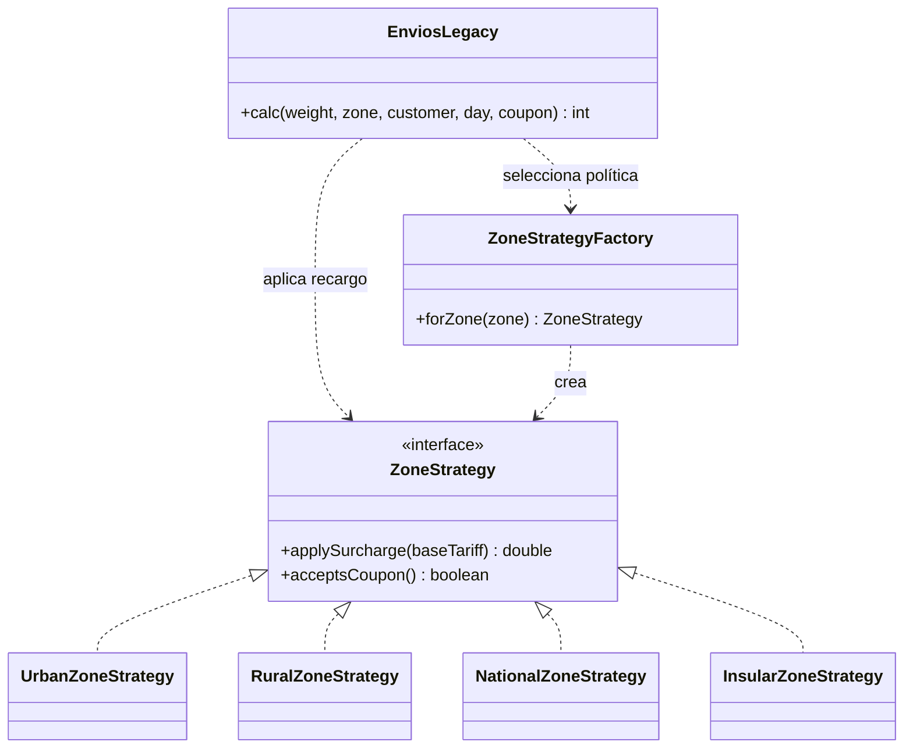

# Parcial 3 — Avance del informe

**Asignatura:** Ingeniería de Software I

**Proyecto:** EnvíaYa

**Estudiante:** Eduardo Jose Diazgranados Mejia

**Código estudiantil:** 182310040
**Estado:** Partes 1–6 implementadas; solicitud CR-00 de la Parte 8 implementada
en una rama separada. Parte 7 está en progreso; faltan integrar y etiquetar
las versiones.

> Los resultados de la Parte 3 son expectativas calculadas manualmente. La
> Parte 5 registra la ejecución real contra la traducción Java del código
> heredado.

## Parte 1 — Requisitos y criterios de aceptación

### 1.1 Parámetros personalizados

Los últimos seis dígitos del código son `310040`: A=3, B=1, C=0, D=0, E=4 y
F=0.

| Parámetro | Cálculo | Valor |
|---|---|---:|
| PMAX | 30 + 5 × A | 45 kg |
| L1 | 2 + (B mod 3) | 3 kg |
| L2 | 10 + C | 10 kg |
| RR | 10 + 5 × (E mod 4) | 10 % |
| RN | 40 + 5 × (F mod 3) | 40 % |
| V | 10 + 5 × (A mod 3) | 10 % |
| S | 2000 + 500 × (C mod 4) | $2.000 |
| CAMBIO | (A + F) mod 3 | 0 |

Reglas de paridad:

- D=0 es par: el tramo 1 incluye L1 (`peso ≤ 3 kg`).
- E=4 es par: el recargo de fin de semana se suma antes de los descuentos.
- B=1 es impar: si aplican descuento de cliente y cupón, se aplican ambos,
  primero el del cliente y luego el del cupón.
- F=0 es par: los cupones inexistentes se ignoran.

### 1.2 Requisitos

- **R1 — Peso:** `0 < peso ≤ 45 kg`; en caso contrario, lanzar un error con el
  mensaje exacto `peso inválido`.
- **R2 — Zona y día:** zona `urbana`, `rural` o `nacional`; día entero de 1 a 7.
  Si la zona o el día son inválidos, lanzar un error. El enunciado no especifica
  el mensaje.
- **R3 — Tarifa base:** `0 < peso ≤ 3`: $6.000; `3 < peso ≤ 10`: $9.000;
  `peso > 10`: `$9.000 + $800 × (peso − 10)`, proporcionalmente.
- **R4 — Zona:** urbana sin recargo; rural +10 %; nacional +40 % sobre la tarifa
  base.
- **R5 — Fin de semana:** días 6 y 7 agregan $2.000 después del recargo de zona
  y antes de los descuentos; días 1–5 no agregan este recargo.
- **R6 — Descuentos:** normal 0 %, frecuente 5 %, VIP 10 %; el cupón `ENVIO10`
  aplica 10 %. Si hay descuento de cliente y cupón, se aplican
  secuencialmente, primero el del cliente.
- **R7 — Cupón inexistente:** un cupón distinto de `ENVIO10` se ignora.
- **R8 — Mínimo y redondeo:** mínimo de $5.000; redondeo al múltiplo de $100 más
  cercano, con empates de $50 hacia arriba.

### 1.3 Historias y criterios de aceptación

#### HU-01 — Validar el envío y calcular la tarifa base

**Como** persona que solicita un envío, **quiero** que el sistema valide los
datos y calcule la tarifa base según el peso, **para** evitar entradas no
permitidas y obtener el costo inicial correcto.

| ID | Dado | Cuando | Entonces |
|---|---|---|---|
| CA-01 | Peso 0 kg y los demás datos válidos | Se solicita el cálculo | Se lanza `IllegalArgumentException` con `peso inválido`. |
| CA-02 | Peso −1 kg y los demás datos válidos | Se solicita el cálculo | Se lanza `IllegalArgumentException` con `peso inválido`. |
| CA-03 | 45 kg, zona urbana, cliente normal, día 1, sin cupón | Se solicita el cálculo | Se acepta el peso y el costo es $37.000. |
| CA-04 | 45,001 kg y los demás datos válidos | Se solicita el cálculo | Se lanza `IllegalArgumentException` con `peso inválido`. |
| CA-05 | Zona inválida y los demás datos válidos | Se solicita el cálculo | Se lanza un error; el mensaje no está especificado. |
| CA-06 | Día 0 u 8 y los demás datos válidos | Se solicita el cálculo | Se lanza un error; el mensaje no está especificado. |
| CA-07 | 3 kg, urbana, normal, día 1, sin cupón | Se calcula | Tarifa y resultado: $6.000. |
| CA-08 | 3,001 kg, urbana, normal, día 1, sin cupón | Se calcula | Tarifa y resultado: $9.000. |
| CA-09 | 10 kg, urbana, normal, día 1, sin cupón | Se calcula | Tarifa y resultado: $9.000. |
| CA-10 | 10,125 kg, urbana, normal, día 1, sin cupón | Se calcula | Tarifa y resultado: $9.100. |

#### HU-02 — Aplicar recargos

**Como** persona que solicita un envío, **quiero** que se apliquen los recargos
por zona y día, **para** que el costo refleje las condiciones del servicio.

| ID | Dado | Cuando | Entonces |
|---|---|---|---|
| CA-11 | 4 kg, urbana, normal, día 1, sin cupón | Se calcula | Resultado: $9.000. |
| CA-12 | 4 kg, rural, normal, día 1, sin cupón | Se calcula | Resultado: $9.900. |
| CA-13 | 4 kg, nacional, normal, día 1, sin cupón | Se calcula | Resultado: $12.600. |
| CA-14 | 4 kg, rural, normal, día 6, sin cupón | Se calcula | Resultado: $11.900; recargo de fin de semana antes de descuentos. |
| CA-15 | 4 kg, rural, normal, día 7, sin cupón | Se calcula | Resultado: $11.900. |
| CA-16 | 4 kg, rural, normal, día 5, sin cupón | Se calcula | Resultado: $9.900; sin recargo de fin de semana. |

#### HU-03 — Aplicar descuentos y obtener el costo final

**Como** persona que solicita un envío, **quiero** que se apliquen descuentos,
mínimo y redondeo, **para** conocer el costo final correcto.

| ID | Dado | Cuando | Entonces |
|---|---|---|---|
| CA-17 | 4 kg, urbana, frecuente, día 1, sin cupón | Se calcula | $9.000 × 0,95 = $8.550; redondeado: $8.600. |
| CA-18 | 4 kg, urbana, VIP, día 1, sin cupón | Se calcula | Resultado: $8.100. |
| CA-19 | 4 kg, urbana, normal, día 1, `ENVIO10` | Se calcula | Resultado: $8.100. |
| CA-20 | 4 kg, urbana, frecuente, día 1, `ENVIO10` | Se calcula | $9.000 × 0,95 × 0,90 = $7.695; redondeado: $7.700. |
| CA-21 | 4 kg, urbana, normal, día 1, cupón `OTRO` | Se calcula | El cupón se ignora; resultado: $9.000. |
| CA-22 | 3 kg, urbana, VIP, día 1, `ENVIO10` | Se calcula | $6.000 × 0,90 × 0,90 = $4.860; con mínimo: $5.000. |
| CA-23 | 11,4375 kg, urbana, normal, día 1, sin cupón | Se calcula | $10.150 se redondea a $10.200. |

### 1.4 Trazabilidad inicial

Los casos CP se detallan en la Parte 3.

| Requisito | Historia | Casos |
|---|---|---|
| R1 | HU-01 | CP-01–CP-04, CP-25, CP-27 |
| R2 | HU-01, HU-02, HU-04 | CP-05–CP-07, CP-12–CP-14, CR-01–CR-04 |
| R3 | HU-01 | CP-03, CP-08–CP-11, CP-25–CP-27, CP-41–CP-42 |
| R4 | HU-02, HU-04 | CP-12–CP-14, CR-01–CR-04 |
| R5 | HU-02 | CP-15–CP-17, CP-28–CP-33, CP-35–CP-36, CP-38, CP-40 |
| R6 | HU-03 | CP-18–CP-21, CP-28, CP-30, CP-32–CP-40 |
| R7 | HU-03, HU-04 | CP-22, CP-31, CP-34–CP-35, CP-39–CP-40, CR-02–CR-04 |
| R8 | HU-03 | CP-23–CP-24; el redondeo también aplica a todos los resultados válidos |

La zona insular corresponde a `CAMBIO=0` y se trata como evolución de la Parte
8, no como requisito inicial R1–R8. La decisión acordada para esa evolución es
aplicar el recargo del 70 % e ignorar cualquier cupón proporcionado. El
enunciado no define el comportamiento para tipos de cliente no listados ni
formatos alternativos; no se inventa una regla para esos casos.

## Parte 2 — Plan de pruebas

### Objetivo y alcance

Comprobar R1–R8, descubrir defectos del código heredado y verificar las
correcciones, la refactorización y la solicitud de cambio. Se evaluarán por
separado:

1. La traducción Java del legado, sin corregir su lógica.
2. La versión corregida y refactorizada, incluida la eliminación de `flag`.
3. La versión evolucionada con zona insular, recargo 70 % y cupón ignorado.

No se incluyen interfaz gráfica, persistencia ni servicios externos porque el
enunciado no los requiere.

### Niveles

| Nivel | Aplicación |
|---|---|
| Unidad | Validación, tarifa base, recargos, descuentos, mínimo y redondeo de forma aislada. |
| Integración | Colaboración de componentes en el orden de negocio; interacción de estrategia insular con cupones. |
| Sistema | Invocar el método público Java con entradas completas y verificar costo o excepción; no se presupone UI. |
| Aceptación | Contrastar resultados con los criterios Dado/Cuando/Entonces y requisitos personalizados; comprobar también la regla insular acordada. |

### Estrategia

1. Confirmar parámetros personalizados.
2. Traducir el código legado a Java preservando lógica y revisar la traducción.
3. Diseñar pruebas de caja negra y blanca con ID, requisito, entrada, expectativa
   y técnica.
4. Ejecutar JUnit contra el legado, comparar resultados y reproducir antes de
   registrar defectos.
5. Corregir y refactorizar; repetir la misma suite como regresión. Actualizar
   solo las pruebas afectadas por cambios intencionales de interfaz, como
   retirar `flag`.
6. Escribir primero las pruebas de zona insular y después implementarla.
7. Medir cobertura de sentencias y ramas con JaCoCo, sin imponer un umbral que
   el parcial no exige.

En Java se usará la excepción apropiada, como `IllegalArgumentException`. El
mensaje exacto `peso inválido` se verifica solo para R1; para R2 se verifica la
excepción, no un mensaje no especificado.

### Registro, ambiente y roles

Cada ejecución conservará ID, versión/commit, entradas, resultado esperado,
resultado obtenido, estado (aprobado, fallido, error o no ejecutado) y defecto
relacionado. Un fallo no se considera defecto hasta reproducirlo y contrastarlo
con un requisito.

Lenguaje Java; JUnit para pruebas; JaCoCo para cobertura; Git/GitHub para
configuración. El informe anotará las versiones reales de JDK y herramientas,
y comandos de ejecución. El estudiante cumple roles de analista, desarrollador
y tester; el docente revisa y participa en la sustentación.

### Riesgos y mitigación

| Riesgo | Mitigación |
|---|---|
| Parámetros inconsistentes | Recalcular desde el código estudiantil y verificarlos en informe, configuración y pruebas. |
| Traducción altera legado | Comparar flujo y expresiones antes de usarlo como línea base. |
| Expectativas erróneas | Cálculo manual, al menos cinco procedimientos explicados y revisión de límites/orden. |
| Pruebas poco representativas | Combinar particiones, límites, tabla de decisión y caminos independientes. |
| Regresiones | Reejecutar la suite y distinguir cambios intencionales. |
| Ambigüedad insular | Registrar la decisión: 70 % e ignorar cualquier cupón; añadir pruebas. |
| Pérdida de trazabilidad | Commits progresivos, ramas, etiquetas e historial exigidos. |

### Criterios de entrada y salida

**Entrada a pruebas del legado:** parámetros revisados; requisitos y casos
diseñados; traducción revisada; JDK/JUnit configurados con ejecución de prueba
confirmada.

**Salida del legado:** casos ejecutados o motivo de no ejecución registrado;
resultados comparados; fallos reproducibles contrastados y defectos
documentados; cobertura y herramienta registradas. No se exige que el legado
pase toda la suite.

**Salida corregida/refactorizada:** suite de regresión ejecutada; defectos
corregidos o excepciones justificadas; eliminación de `flag` verificada;
cobertura y comparación antes/después registradas.

**Salida evolucionada:** pruebas escritas antes del cambio; recargo insular
verificado; casos con y sin cupones cubiertos; regresión ejecutada; impacto y
CHANGELOG actualizados.

### Métricas

- Porcentaje aprobado = `casos aprobados / casos ejecutados × 100`; los no
  ejecutados se excluyen y reportan aparte.
- Defectos confirmados agrupados por severidad.
- Densidad = `defectos confirmados / líneas de código × 100`; indicar versión y
  criterio de conteo, sin mezclar versiones.
- Cobertura de sentencias y ramas reportada por JaCoCo, indicando versión.

Se conservarán salidas de prueba, capturas, cobertura y `git log --oneline
--graph --all`, además de ramas e integraciones requeridas. Los resultados se
reportarán, no se inventarán metas ni ejecuciones.

## Parte 3 — Diseño de caja negra

### Particiones de equivalencia

| Entrada | Particiones válidas | Inválidas o especiales |
|---|---|---|
| Peso | `0 < p ≤ 3`; `3 < p ≤ 10`; `10 < p ≤ 45` | `p ≤ 0`; `p > 45` |
| Zona | urbana, rural, nacional | cualquier otro valor |
| Cliente | normal, frecuente, VIP | comportamiento no especificado para otros |
| Día | 1–5; 6–7 | menor que 1 o mayor que 7 |
| Cupón | ausente; `ENVIO10` | otro: se ignora porque F es par |

La zona insular no forma parte de estas particiones iniciales; corresponde a
Parte 8.

### Valores límite

| Límite | Inferior | Límite | Superior | Expectativa |
|---|---:|---:|---:|---|
| 0 | −0,001 | 0 | 0,001 | primeros dos inválidos; 0,001 válido |
| L1 = 3 | 2,999 | 3 | 3,001 | 3 va a tramo 1; sobre 3, tramo 2 |
| L2 = 10 | 9,999 | 10 | 10,001 | hasta 10 base $9.000; sobre 10 inicia incremento proporcional |
| PMAX = 45 | 44,999 | 45 | 45,001 | hasta 45 válido; superior inválido |

### Tabla de decisión: cliente × cupón × fin de semana

El fin de semana se suma antes de los descuentos; el descuento del cliente se
aplica antes del cupón.

| Regla | Cliente | Cupón | Finde | Caso |
|---|---|---|---|---|
| D01 | Normal | Ausente | No | CP-12 |
| D02 | Normal | Ausente | Sí | CP-29 |
| D03 | Normal | `ENVIO10` | No | CP-20 |
| D04 | Normal | `ENVIO10` | Sí | CP-30 |
| D05 | Normal | Otro | No | CP-22 |
| D06 | Normal | Otro | Sí | CP-31 |
| D07 | Frecuente | Ausente | No | CP-18 |
| D08 | Frecuente | Ausente | Sí | CP-32 |
| D09 | Frecuente | `ENVIO10` | No | CP-21 |
| D10 | Frecuente | `ENVIO10` | Sí | CP-33 |
| D11 | Frecuente | Otro | No | CP-34 |
| D12 | Frecuente | Otro | Sí | CP-35 |
| D13 | VIP | Ausente | No | CP-19 |
| D14 | VIP | Ausente | Sí | CP-36 |
| D15 | VIP | `ENVIO10` | No | CP-37 |
| D16 | VIP | `ENVIO10` | Sí | CP-38 |
| D17 | VIP | Otro | No | CP-39 |
| D18 | VIP | Otro | Sí | CP-40 |

### Casos de prueba

Todos los casos válidos aplican mínimo de $5.000 y después redondean a centenas
con empate hacia arriba. “Error R1” significa `IllegalArgumentException` con
mensaje `peso inválido`; para R2 se exige excepción, pero no mensaje específico.

| ID | Req. | Peso, zona, cliente, día, cupón | Resultado esperado | Técnica |
|---|---|---|---:|---|
| CP-01 | R1 | 0, urbana, normal, 1, ausente | Error R1 | Límite inferior |
| CP-02 | R1 | −1, urbana, normal, 1, ausente | Error R1 | Partición inválida |
| CP-03 | R1,R3 | 45, urbana, normal, 1, ausente | $37.000 | PMAX válido |
| CP-04 | R1 | 45,001, urbana, normal, 1, ausente | Error R1 | PMAX inválido |
| CP-05 | R2 | 4, periurbana, normal, 1, ausente | Error; mensaje libre | Zona inválida |
| CP-06 | R2 | 4, urbana, normal, 0, ausente | Error; mensaje libre | Día inferior |
| CP-07 | R2 | 4, urbana, normal, 8, ausente | Error; mensaje libre | Día superior |
| CP-08 | R3 | 3, urbana, normal, 1, ausente | $6.000 | Límite L1 |
| CP-09 | R3 | 3,001, urbana, normal, 1, ausente | $9.000 | Sobre L1 |
| CP-10 | R3 | 10, urbana, normal, 1, ausente | $9.000 | Límite L2 |
| CP-11 | R3 | 10,125, urbana, normal, 1, ausente | $9.100 | Proporcional |
| CP-12 | R4 | 4, urbana, normal, 1, ausente | $9.000 | Zona urbana |
| CP-13 | R4 | 4, rural, normal, 1, ausente | $9.900 | Zona rural |
| CP-14 | R4 | 4, nacional, normal, 1, ausente | $12.600 | Zona nacional |
| CP-15 | R5 | 4, urbana, normal, 6, ausente | $11.000 | Sábado |
| CP-16 | R5 | 4, rural, normal, 7, ausente | $11.900 | Domingo y rural |
| CP-17 | R5 | 4, rural, normal, 5, ausente | $9.900 | Día hábil |
| CP-18 | R6 | 4, urbana, frecuente, 1, ausente | $8.600 | Descuento frecuente |
| CP-19 | R6 | 4, urbana, VIP, 1, ausente | $8.100 | Descuento VIP |
| CP-20 | R6 | 4, urbana, normal, 1, `ENVIO10` | $8.100 | Cupón válido |
| CP-21 | R6 | 4, urbana, frecuente, 1, `ENVIO10` | $7.700 | Cliente + cupón |
| CP-22 | R7 | 4, urbana, normal, 1, `OTRO` | $9.000 | Cupón inválido |
| CP-23 | R8 | 3, urbana, VIP, 1, `ENVIO10` | $5.000 | Mínimo |
| CP-24 | R8 | 11,4375, urbana, normal, 1, ausente | $10.200 | Empate de redondeo |
| CP-25 | R1,R3 | 0,001, urbana, normal, 1, ausente | $6.000 | Justo sobre cero |
| CP-26 | R3 | 10,001, urbana, normal, 1, ausente | $9.000 | Justo sobre L2 |
| CP-27 | R1,R3 | 44,999, urbana, normal, 1, ausente | $37.000 | Justo bajo PMAX |
| CP-28 | R5,R6 | 4, rural, frecuente, 6, ausente | $11.300 | Orden recargo/descuento |
| CP-29 | R5 | 4, urbana, normal, 6, ausente | $11.000 | Tabla D02 |
| CP-30 | R5,R6 | 4, urbana, normal, 6, `ENVIO10` | $9.900 | Tabla D04 |
| CP-31 | R5,R7 | 4, urbana, normal, 6, `OTRO` | $11.000 | Tabla D06 |
| CP-32 | R5,R6 | 4, urbana, frecuente, 6, ausente | $10.500 | Tabla D08 |
| CP-33 | R5,R6 | 4, urbana, frecuente, 6, `ENVIO10` | $9.400 | Tabla D10 |
| CP-34 | R6,R7 | 4, urbana, frecuente, 1, `OTRO` | $8.600 | Tabla D11 |
| CP-35 | R5,R6,R7 | 4, urbana, frecuente, 6, `OTRO` | $10.500 | Tabla D12 |
| CP-36 | R5,R6 | 4, urbana, VIP, 6, ausente | $9.900 | Tabla D14 |
| CP-37 | R6 | 4, urbana, VIP, 1, `ENVIO10` | $7.300 | Tabla D15 |
| CP-38 | R5,R6 | 4, urbana, VIP, 6, `ENVIO10` | $8.900 | Tabla D16 |
| CP-39 | R6,R7 | 4, urbana, VIP, 1, `OTRO` | $8.100 | Tabla D17 |
| CP-40 | R5,R6,R7 | 4, urbana, VIP, 6, `OTRO` | $9.900 | Tabla D18 |
| CP-41 | R3 | 2,999, urbana, normal, 1, ausente | $6.000 | Justo bajo L1 |
| CP-42 | R3 | 9,999, urbana, normal, 1, ausente | $9.000 | Justo bajo L2 |

### Cálculos manuales representativos

- **CP-03:** `$9.000 + (45 − 10) × $800 = $37.000`; urbana y normal, sin más
  ajustes.
- **CP-14:** `$9.000 + 40 % × $9.000 = $12.600`.
- **CP-21:** `$9.000 × 0,95 × 0,90 = $7.695`; redondeo: `$7.700`.
- **CP-23:** `$6.000 × 0,90 × 0,90 = $4.860`; mínimo: `$5.000`.
- **CP-24:** `$9.000 + (11,4375 − 10) × $800 = $10.150`; empate hacia arriba:
  `$10.200`.
- **CP-28:** `($9.000 + $900 + $2.000) × 0,95 = $11.305`; redondeo:
  `$11.300`.

En Java, pesos decimales deben construirse desde texto (por ejemplo,
`new BigDecimal("10.125")`). El dinero se redondeará a centenas con
`RoundingMode.HALF_UP`; se comparará el valor numérico, no la escala de
`BigDecimal`.

## Parte 4 — Diseño de caja blanca

Se analiza el código heredado. Para complejidad, la expresión compuesta del
peso se cuenta como un predicado (un `if`); sus operandos se cubren aparte en
pruebas de condiciones.

### Grafo de flujo

```mermaid
flowchart TD
    IN[Inicio] --> D1{p <= 0 or p > 50?}
    D1 -- Sí --> ERR[Lanzar error de peso]
    ERR --> OUT[Fin]
    D1 -- No --> D2{p <= L1?}
    D2 -- Sí --> T1[t = 6000]
    D2 -- No --> D3{p <= L2?}
    D3 -- Sí --> T2[t = 9000]
    D3 -- No --> T3[t = 9000 + (p-L2)*800]
    T1 --> D4{zona == urbana?}
    T2 --> D4
    T3 --> D4
    D4 -- Sí --> URB[t = t]
    D4 -- No --> D5{zona == rural?}
    D5 -- Sí --> RUR[Aplicar recargo rural]
    D5 -- No --> D6{zona == nacional?}
    D6 -- Sí --> NAC[Aplicar recargo nacional]
    D6 -- No --> D7{día > 6?}
    URB --> D7
    RUR --> D7
    NAC --> D7
    D7 -- Sí --> FDS[Sumar recargo de fin de semana]
    D7 -- No --> D8{cliente frecuente?}
    FDS --> D8
    D8 -- Sí --> FREC[Aplicar 5%]
    D8 -- No --> D9{cliente VIP?}
    FREC --> D9
    D9 -- Sí --> VIP[Aplicar descuento VIP]
    D9 -- No --> D10{cup != None?}
    VIP --> D10
    D10 -- Sí --> D11{cup == ENVIO10?}
    D10 -- No --> D12{t < 5000?}
    D11 -- Sí --> CUP[Aplicar 10%]
    D11 -- No --> D12
    CUP --> D12
    D12 -- Sí --> MIN[Establecer mínimo 5000]
    D12 -- No --> D13{flag?}
    MIN --> D13
    D13 -- Sí --> PRINT[Imprimir costo]
    D13 -- No --> RET[Retornar costo]
    PRINT --> RET
    RET --> OUT
```

### Complejidad ciclomática

Con el grafo conectado, `P=1`, `N=29`, `E=41` y 13 nodos predicado:

| Método | Cálculo | Resultado |
|---|---|---:|
| Aristas y nodos | `M = E − N + 2P = 41 − 29 + 2` | 14 |
| Nodos predicado | `13 + 1` | 14 |
| Regiones | Regiones del grafo | 14 |

Si se expanden los dos operandos del `or` en decisiones separadas, se obtiene
15 para ese grafo expandido. El valor informado aquí usa de manera consistente
la convención clásica por instrucciones `if`.

### Caminos independientes propuestos

En todos, salvo indicación, los demás datos son zona urbana, cliente normal,
día 1, sin cupón y `flag=false`.

| ID | Camino / entrada | Resultado heredado esperado |
|---|---|---:|
| WB-01 | Recorrido base: 4 kg | $9.000 |
| WB-02 | Peso 0 kg | Error de peso |
| WB-03 | Tramo 1: 3 kg | $6.000 |
| WB-04 | Superior a L2: 11 kg | $9.800 |
| WB-05 | Zona rural, 4 kg | $9.900 |
| WB-06 | Zona nacional, 4 kg | $12.600 |
| WB-07 | Zona `periurbana`, 4 kg | $9.000; no lanza error |
| WB-08 | Día 7, 4 kg | $11.000 |
| WB-09 | Cliente frecuente, 4 kg | $8.500; el legado trunca $8.550 |
| WB-10 | Cliente VIP, 4 kg | $8.100 |
| WB-11 | Cupón `ENVIO10`, 4 kg | $8.100 |
| WB-12 | Cupón `OTRO`, 4 kg | $9.000 |
| WB-13 | 3 kg, VIP, `ENVIO10` | $5.000 mínimo |
| WB-14 | `flag=true`, 4 kg | Imprime y retorna $9.000 |

### Cobertura de ramas

| Decisión | Rama verdadera | Rama falsa |
|---|---|---|
| Peso inválido | WB-02 | WB-01 |
| `p <= L1` | WB-03 | WB-01 |
| `p <= L2` | WB-01 | WB-04 |
| Zona urbana | WB-01 | WB-05 |
| Zona rural | WB-05 | WB-06 |
| Zona nacional | WB-06 | WB-07 |
| `día > 6` | WB-08 | WB-01 |
| Cliente frecuente | WB-09 | WB-01 |
| Cliente VIP | WB-10 | WB-01 |
| Cupón presente | WB-11 | WB-01 |
| Cupón válido | WB-11 | WB-12 |
| `t < 5000` | WB-13 | WB-01 |
| `flag` | WB-14 | WB-01 |

Para condiciones atómicas del peso: WB-02 (`p<=0` verdadero), WB-15 (`p<=0`
falso y `p>50` verdadero, con 51 kg) y WB-01 (ambas falsas).

### Casos adicionales para contrastar requisitos

| ID | Entrada | Comportamiento del legado esperado | Requisito |
|---|---|---|---|
| WB-15 | 51 kg | Lanza error por límite heredado de 50 kg | Segunda condición atómica |
| WB-16 | 45,001 kg | Acepta; la base se trunca al retornar | R1 requiere error por PMAX=45 |
| WB-17 | Día 6 | No suma recargo porque usa `d > 6` | R5 requiere recargo el sábado |
| WB-18 | Día 0 | Acepta la entrada | R2 requiere error |
| WB-19 | Día 8 | Acepta y suma recargo | R2 requiere error |
| WB-20 | 11,4375 kg | Trunca $10.150 a $10.100 | R8 requiere $10.200 |

La suite WB-01–WB-14 está diseñada para cubrir instrucciones y ambas ramas de
las decisiones; WB-15 comprueba además la segunda condición atómica. WB-16–20
contrastan requisitos concretos. La cobertura real se mide en la Parte 5.

El flujo heredado muestra discrepancias que se comprobaron en la Parte 5:
límite de 50 kg
en vez de 45 kg; zona desconocida que continúa sin recargo; ausencia de
validación del rango de días; recargo de fin de semana solo para el día 7; y
truncamiento en vez de redondeo HALF_UP. `flag` controla una impresión que se
eliminará al refactorizar.

## Parte 5 — Automatización, ejecución y defectos

### 5.1 Automatización

El código heredado se tradujo a Java en `EnviosLegacy.calc`, conservando sus
reglas y defectos. La traducción se compiló antes de probarse. Los 42 casos CP
de caja negra se implementaron como pruebas JUnit Jupiter con nombres
individuales por ID; se agregaron dos casos de caja blanca (`WB-14` para
`flag=true` y `WB-15` para el límite heredado de 50 kg). Así, los reportes
identifican cada caso en lugar de agruparlos bajo un único nombre de método.

Herramientas usadas:

- Eclipse Temurin JDK 8u512.
- Apache Maven 3.9.9.
- JUnit Jupiter 5.10.2.
- JaCoCo 0.8.12.

Comando de ejecución normal:

```text
mvn test
```

La línea base debe fallar según lo esperado por sus defectos. Para que JaCoCo
generara el informe pese a esos fallos, se ejecutó:

```text
mvn clean verify -Dmaven.test.failure.ignore=true
```

**Importante:** esta opción permite completar el ciclo y producir cobertura;
el resultado de Maven no significa que las pruebas hayan pasado. El reporte de
JUnit registra los fallos.

Archivos de informe generados localmente:

- JaCoCo HTML: `target/site/jacoco/index.html`.
- JUnit de texto: `target/surefire-reports/edu.uniguajira.enviaya.EnviosLegacyTest.txt`.
- JUnit XML: `target/surefire-reports/TEST-edu.uniguajira.enviaya.EnviosLegacyTest.xml`.
- [Captura de la ejecución JUnit del legado](evidence/pruebas-legado.png).
- [Captura del informe de cobertura JaCoCo](evidence/cobertura-jacoco.png).

### 5.2 Resultado contra el código heredado

| Grupo | Ejecutadas | Pasaron | Fallaron | Aprobación |
|---|---:|---:|---:|---:|
| Caja negra CP-01–CP-42 | 42 | 19 | 23 | 45,24 % |
| Caja blanca WB-14 y WB-15 | 2 | 2 | 0 | 100 % |
| Total JUnit | 44 | 21 | 23 | 47,73 % |

No hubo errores de ejecución ni pruebas omitidas. La línea base no cumple R1,
R2, R5 y R8; por eso los fallos forman parte del análisis y no son una
validación de la versión corregida.

### 5.3 Cobertura

JaCoCo midió la clase de producción `EnviosLegacy`:

| Métrica JaCoCo | Cubiertos | Total | Cobertura |
|---|---:|---:|---:|
| Instrucciones de bytecode | 127 | 127 | 100 % |
| Líneas | 27 | 27 | 100 % |
| Ramas | 28 | 28 | 100 % |

JaCoCo no presenta un contador independiente llamado “sentencias”; se
reportan sus contadores de instrucciones y líneas como medidas de sentencias,
y el contador de ramas como cobertura de ramas. La cobertura completa de esta
clase no implica que la lógica cumpla los requisitos: las pruebas pueden
cubrir una rama defectuosa y demostrar su resultado incorrecto.

### 5.4 Registro de defectos confirmados

Se agrupan fallos de pruebas que comparten una misma causa. Prioridad P1
significa corregir antes de publicar la versión reparada; P2 es necesaria para
conformidad funcional antes de cerrar la entrega; P3 es de menor impacto, pero
se corrige porque el requisito exige el texto exacto.

| ID | Título y requisito | Reproducción | Esperado | Obtenido | Severidad / prioridad |
|---|---|---|---|---|---|
| DEF-01 | Límite máximo fijo incorrecto (R1), [EnviosLegacy.java en v1.0.0](https://github.com/EduardoDiazGranados38/EnviaYa/blob/v1.0.0/src/main/java/edu/uniguajira/enviaya/EnviosLegacy.java#L15) | CP-04: `45,001 kg`, urbana, normal, día 1 | Se lanza una excepción porque PMAX=45 | Se acepta; devuelve $37.000 | Alta / P1: permite procesar un peso que la especificación prohíbe. |
| DEF-02 | Mensaje de peso no coincide (R1), [EnviosLegacy.java en v1.0.0](https://github.com/EduardoDiazGranados38/EnviaYa/blob/v1.0.0/src/main/java/edu/uniguajira/enviaya/EnviosLegacy.java#L16) | CP-01 o CP-02 con peso inválido | “peso inválido” | Lanza excepción con “peso invalido” (sin tilde) | Baja / P3: incumple el contrato textual, aunque sí rechaza el peso. |
| DEF-03 | No se rechaza una zona inválida (R2), [EnviosLegacy.java en v1.0.0](https://github.com/EduardoDiazGranados38/EnviaYa/blob/v1.0.0/src/main/java/edu/uniguajira/enviaya/EnviosLegacy.java#L28) | CP-05: `4 kg`, zona `periurbana`, normal, día 1 | Excepción | Continúa sin recargo y devuelve $9.000 | Alta / P1: procesa entradas de zona no permitidas con tarifa incorrecta. |
| DEF-04 | No se valida el rango del día (R2), [EnviosLegacy.java en v1.0.0](https://github.com/EduardoDiazGranados38/EnviaYa/blob/v1.0.0/src/main/java/edu/uniguajira/enviaya/EnviosLegacy.java#L36) | CP-06: día 0; CP-07: día 8 | Excepción para ambos | Día 0 devuelve $9.000; día 8 se acepta y agrega el recargo, $11.000 | Alta / P1: acepta valores fuera del dominio y el día 8 altera el precio. |
| DEF-05 | Se omite el recargo del sábado (R5), [EnviosLegacy.java en v1.0.0](https://github.com/EduardoDiazGranados38/EnviaYa/blob/v1.0.0/src/main/java/edu/uniguajira/enviaya/EnviosLegacy.java#L36) | CP-15: `4 kg`, urbana, normal, día 6 | $11.000 | $9.000 | Alta / P1: produce cobros inferiores a la regla para envíos de sábado. |
| DEF-06 | Se trunca en vez de redondear HALF_UP (R8), [EnviosLegacy.java en v1.0.0](https://github.com/EduardoDiazGranados38/EnviaYa/blob/v1.0.0/src/main/java/edu/uniguajira/enviaya/EnviosLegacy.java#L59) | CP-24: `11,4375 kg`; también CP-18, CP-21 y CP-27 | CP-24: $10.200; CP-18: $8.600; CP-21: $7.700; CP-27: $37.000 | CP-24: $10.100; CP-18: $8.500; CP-21: $7.600; CP-27: $36.900 | Media / P2: altera el monto final en resultados que requieren redondeo. |

Un mismo caso puede evidenciar más de un defecto. Por ejemplo, CP-28 combina
la omisión del recargo de sábado con el truncamiento. Los 23 fallos no se
cuentan como 23 defectos: el registro identifica seis causas diferenciadas.

### 5.5 Métricas de defectos

- Defectos confirmados por severidad: **0 críticos, 4 altos, 1 medio y 1 bajo**.
- Líneas de código: **52 SLOC** en `EnviosLegacy.java`, contando líneas no
  vacías y excluyendo comentarios.
- Densidad: `6 defectos ÷ 52 SLOC × 100 = 11,54 defectos por cada 100 líneas`.

La densidad se calcula sobre la clase heredada y usa causas raíz únicas, no
fallos de prueba. Se recalculará para la versión final usando el mismo criterio.

### 5.6 Avance de correcciones

Las correcciones se trabajan en ramas secuenciales: cada rama incorpora los
arreglos anteriores y uno nuevo. No modifican la etiqueta `v1.0.0` ni
reemplazan sus resultados históricos.

| Rama | Defecto | Cambio | Verificación |
|---|---|---|---|
| `fix/DEF-01` | DEF-01 | El límite de peso usa PMAX=45 kg. | CP-04 pasa. |
| `fix/DEF-02` | DEF-02 | El error de peso ahora usa exactamente `peso inválido`. | CP-01 y CP-02 pasan; la regresión completa ejecuta 44 pruebas: 24 pasan y 20 siguen fallando por defectos pendientes. |
| `fix/DEF-03` | DEF-03 | Se rechazan las zonas distintas de `urbana`, `rural` y `nacional`. | CP-05 pasa; la regresión completa ejecuta 44 pruebas: 25 pasan y 19 siguen fallando por defectos pendientes. |
| `fix/DEF-04` | DEF-04 | Se rechazan los días menores que 1 o mayores que 7. | CP-06 y CP-07 pasan; la regresión completa ejecuta 44 pruebas: 27 pasan y 17 siguen fallando por defectos pendientes. |
| `fix/DEF-05` | DEF-05 | El recargo de fin de semana aplica los días 6 y 7. | CP-15, CP-16 y CP-17 pasan; la regresión completa ejecuta 44 pruebas: 36 pasan y 8 siguen fallando por DEF-06 (redondeo). |
| `fix/DEF-06` | DEF-06 | Se redondea al múltiplo de $100 más cercano, con empates hacia arriba. | CP-18, CP-21, CP-24, CP-27, CP-32, CP-34, CP-35 y CP-37 pasan; las 44 pruebas de regresión pasan. |

La tabla de la sección 5.2 conserva la medición de la línea base heredada
(21 aprobadas y 23 fallidas); no debe confundirse con la regresión posterior a
las correcciones.

## Parte 6 — Mantenimiento y refactorización

### 6.1 Malos olores del código heredado

Las líneas de la tabla corresponden al archivo heredado etiquetado como
`v1.0.0`, antes de los arreglos. Puede consultarse el
[archivo heredado](https://github.com/EduardoDiazGranados38/EnviaYa/blob/v1.0.0/src/main/java/edu/uniguajira/enviaya/EnviosLegacy.java).
Se registra la deuda que originaba cada olor, no solo el cambio aplicado.

| Mal olor (nombre técnico) | Ubicación en `v1.0.0` | Deuda técnica |
|---|---|---|
| Long Method | `calc`, líneas 14–59 | Mezcla validación, tarifa, recargos, descuentos, mínimo, salida y redondeo; un cambio localizado requiere comprender todo el método y aumenta el riesgo de regresión. |
| Magic Numbers | Líneas 15, 21, 23, 25, 41, 48, 52 y 59 | PMAX, tarifas, porcentajes, mínimo y unidad de redondeo carecen de nombres; ajustar o auditar reglas exige buscar literales y puede producir inconsistencias. |
| Flag Argument | Parámetro `flag`, línea 14; uso en 56–58 | El booleano altera la salida secundaria del cálculo y amplía la interfaz pública con un modo difícil de inferir desde la llamada. |
| Primitive Obsession | Parámetros de `calc`, línea 14; comparaciones de zona, cliente y cupón en 28–48 | Strings y primitivos representan conceptos del dominio sin tipos ni políticas explícitas; validación y reglas quedan acopladas a comparaciones textuales. |
| Long Parameter List | Firma de `calc`, línea 14 | Seis parámetros posicionales hacen las llamadas menos legibles y facilitan intercambiar u omitir datos. |
| Type Code with Conditional | Cadena de condiciones por zona, líneas 28–34 | Las reglas de cada zona están codificadas en una selección condicional; añadir una zona obliga a modificar el método central y eleva su complejidad. |
| Dead Code / código redundante | Asignación `t = t`, línea 29 | La rama urbana no cambia el valor y solo añade ruido al flujo; mantenerla puede ocultar trabajo real o una regla incompleta. |

### 6.2 Clasificación del mantenimiento

| Cambio | Tipo | Justificación |
|---|---|---|
| DEF-01: límite personalizado PMAX | Correctivo | Corrige aceptación de pesos prohibidos por R1. |
| DEF-02: texto exacto del error de peso | Correctivo | Hace que la excepción cumpla el contrato R1. |
| DEF-03: rechazo de zona inválida | Correctivo | Corrige entradas fuera del dominio R2. |
| DEF-04: validación de días 1–7 | Correctivo | Corrige entradas fuera del dominio R2. |
| DEF-05: recargo de sábado | Correctivo | Hace cumplir R5 para ambos días del fin de semana. |
| DEF-06: redondeo HALF_UP | Correctivo | Hace cumplir el resultado monetario de R8. |
| Extracción de funciones y constantes; eliminación de `flag` | Perfectivo | Mejora la estructura y elimina una opción de salida ajena al cálculo requerido. La eliminación cambia la interfaz pública y se tratará como cambio mayor en versionado semántico. |
| Estrategia para zonas | Perfectivo | Aísla las reglas variables por zona y permite extenderlas sin editar el cálculo central. |
| Pruebas unitarias de estrategias | Preventivo | Detectan regresiones de selección y aplicación de recargos por zona. |
| Zona insular de Parte 8 | Adaptativo | Añade una nueva regla de negocio solicitada, probada antes de implementarse en la rama CR-00. |

### 6.3 Refactorización y patrón Estrategia

En la rama `refactor/estrategia`, `calc` delega en funciones con
responsabilidades concretas: validar peso y día, obtener tarifa base, aplicar
recargos/descuentos, aplicar mínimo y redondear. Los montos y porcentajes
constantes tienen nombres. Se eliminó `flag` y su impresión por consola.

La selección de política de zona se implementa con Estrategia:



La fábrica rechaza zonas desconocidas; cada estrategia aplica su regla:
urbana 0 %, rural 10 % y nacional 40 %. Las pruebas CP-12–CP-14 comprueban la
integración, y seis pruebas unitarias verifican las políticas implementadas,
la regla de cupón y el rechazo de zonas desconocidas o nulas.

`WB-14` se retiró porque probaba exclusivamente la impresión controlada por
`flag`, comportamiento eliminado intencionalmente. Las otras 42 pruebas de
caja negra y WB-15 se conservan; las llamadas se ajustaron a la nueva firma.
La regresión refactorizada antes de la solicitud CR-00 ejecutó **48 pruebas:
48 aprobadas, 0 fallidas**.

### 6.4 Comparación antes y después

Se compara el método `calc` del legado con el mismo punto de entrada después
de extraer funciones. La complejidad agregada incluye también los métodos
auxiliares y las estrategias y, por tanto, no es la misma unidad que la
complejidad del único método heredado.

| Métrica | Legado `v1.0.0` | Refactorización con Estrategia | Interpretación |
|---|---:|---:|---|
| Complejidad ciclomática de `calc` | 14 | 1 | La selección de reglas se delega; la complejidad queda distribuida en validadores, fábrica y políticas. La suma JaCoCo de complejidad de todos los métodos nuevos es 29. |
| SLOC de producción | 52 | 119 | Conteo de líneas no vacías y no comentadas en todos los `.java` de producción; el aumento corresponde a responsabilidades y estrategias explícitas. |
| Instrucciones JaCoCo | 127/127 (100 %) | 190/190 (100 %) | Después se mide todo el código de producción, no solo una clase. |
| Líneas JaCoCo | 27/27 (100 %) | 47/47 (100 %) | Todos los renglones ejecutables quedaron cubiertos. |
| Ramas JaCoCo | 28/28 (100 %) | 26/26 (100 %) | Las ramas nuevas, incluida la selección/rechazo de zona, tienen pruebas. |
| Pruebas aprobadas | 21/44 (47,73 %) en el legado | 48/48 (100 %) antes de CR-00 | Resultado previo a CR-00: 43 casos CP/WB y cinco pruebas de Estrategia; WB-14 se retiró por la eliminación de `flag`. |

Las cifras de cobertura del legado son las mediciones históricas de la Parte 5.
La versión refactorizada se midió con JaCoCo 0.8.12 mediante
`mvn clean verify`; el HTML se genera en `target/site/jacoco/index.html`.
Cobertura total no demuestra por sí sola conformidad: se interpreta junto con
los resultados de pruebas y requisitos.

Evidencias de esta versión:

- [JUnit: 43 casos de caja negra/blanca aprobados](evidence/pruebas-regresion-43.png).
- [JUnit: 5 pruebas de Estrategia aprobadas](evidence/pruebas-estrategias-zona.png).
- [JaCoCo: cobertura de la implementación refactorizada](evidence/cobertura-refactorizada.png).

La implementación está en `refactor/estrategia`, separada de `main`; la
integración de esta rama está pendiente como parte de la Parte 7.

## Parte 7 — Gestión de configuración (en progreso)

### Ramas e integración

- La etiqueta `v1.0.0` conserva la traducción heredada.
- `test/suite` mantiene el trabajo de automatización.
- `fix/DEF-01` a `fix/DEF-06` identifican las correcciones individuales; la
  secuencia se integró en `main` mediante la PR #1.
- La rama local `refactor/estrategia` contiene la descomposición, la
  eliminación de `flag` y el patrón Estrategia. Aún no se ha publicado ni
  integrado en `main`.

### Versionado semántico y notas

El proyecto mantiene `v1.0.0` para la línea base. El retiro del argumento
público `flag` rompe la firma anterior, por lo que la próxima versión estable
será **2.0.0** (cambio MAJOR); Maven indica `2.0.0-SNAPSHOT` en
`refactor/estrategia`. La rama de la solicitud insular avanza a
`2.1.0-SNAPSHOT`. La zona insular de Parte 8 agrega comportamiento compatible y se documentará
como versión menor **2.1.0**. El [CHANGELOG](../CHANGELOG.md) usa el formato
Keep a Changelog; las [notas de versión 2.0.0](notas-version-2.0.0.md) y
[2.1.0](notas-version-2.1.0.md) están marcadas como borrador hasta que se
integren y etiqueten las versiones.

La salida completa de `git log --oneline --graph --all` se añadirá al cerrar
la integración y publicar las etiquetas, para que refleje el historial final.
El historial actual conserva las fechas reales y muestra commits entre las
19:49 y las 21:54 del 11 de noviembre. Los cambios se registraron en commits
progresivos a distintas horas; no se reescriben fechas.

## Parte 8 — Solicitud de cambio y análisis de impacto

### 8.1 Solicitud personalizada CR-00

Los parámetros personalizados dan `(A + F) mod 3 = (3 + 0) mod 3 = 0`, por
lo que corresponde agregar la zona insular de San Andrés, con recargo del 70 %
y sin aceptar cupones.

**HU-04 — Calcular envíos insulares.** Como persona que envía a San Andrés,
quiero que el sistema aplique el recargo insular e ignore cupones, para obtener
una tarifa acorde a la solicitud de cambio.

| ID | Dado | Cuando | Entonces |
|---|---|---|---|
| CA-24 / CR-01 | Envío de 4 kg, zona insular, cliente normal, día 1, sin cupón | Se calcula | Tarifa $9.000 + 70 % = $15.300. |
| CA-25 / CR-02 | Los mismos datos con cupón `ENVIO10` | Se calcula | Se ignora el cupón y el resultado sigue siendo $15.300. |
| CA-26 / CR-03 | Envío de 4 kg, zona insular, frecuente, día 1, `ENVIO10` | Se calcula | Se ignora el cupón; se conserva el descuento de cliente: $15.300 × 0,95 = $14.535, redondeado a $14.500. |
| CA-27 / CR-04 | Envío de 4 kg, zona insular, normal, sábado, `ENVIO10` | Se calcula | Recargo insular antes del recargo de sábado: $15.300 + $2.000 = $17.300; el cupón se ignora. |

### 8.2 Análisis de impacto y trazabilidad

La solicitud agrega una zona al dominio y una excepción de cupón específica.
Se conserva el orden existente: tarifa base, recargo de zona, fin de semana,
descuento del cliente, cupón si la zona lo acepta, mínimo y redondeo.

| Elemento | Impacto |
|---|---|
| Requisitos | R2 amplía sus zonas válidas con `insular`; R4 agrega el recargo de 70 %; R7 conserva cupones en otras zonas, pero CR-00 exige ignorarlos en zona insular. R1, R3, R5, R6 y R8 se mantienen y se comprueban en regresión. |
| Historias | HU-02 amplía reglas de recargo; HU-03 mantiene descuentos y costo final; HU-04 cubre explícitamente la solicitud insular. |
| Casos | CP-05, CP-12–CP-14, CP-18–CP-40 protegen validación y reglas existentes; CR-01–CR-04 prueban tarifa insular sin/con cupón, cliente frecuente y sábado. |
| Código | `ZoneStrategy`, `ZoneStrategyFactory`, la selección de estrategia en `EnviosLegacy.calc`, `applyCouponDiscount` y la política nueva `InsularZoneStrategy`. |
| Suite | `InsularZoneTest` cubre cuatro escenarios de aceptación; `ZoneStrategyTest` verifica recargo y política de cupón insulares. Se ejecuta también la suite previa completa. |
| Documentación/release | Este análisis, `CHANGELOG.md`, notas de versión 2.1.0 y la matriz inicial de trazabilidad. |

### 8.3 Clasificación del mantenimiento

La implementación es **mantenimiento adaptativo**: incorpora una regla de
negocio nueva solicitada, sin alterar la firma pública `calc` ni las políticas
existentes. El ajuste de la trazabilidad, changelog y notas de versión es
documentación asociada al mismo cambio.

### 8.4 Implementación, prueba primero y versión

La rama `feat/CR-00-zona-insular` se creó desde `refactor/estrategia`. Antes
de modificar producción, se añadieron CR-01–CR-03 y se ejecutaron contra el
código existente: las tres terminaron con `IllegalArgumentException: zona
inválida`, confirmando el rojo esperado. Después se implementaron la estrategia
insular, el recargo del 70 % y la política de ignorar cupones.

Verificación con `mvn clean verify`: **53 pruebas, 53 aprobadas, 0 fallidas**.
La versión objetivo pasa de `2.0.0` a `2.1.0` como cambio MINOR compatible,
documentada en el [CHANGELOG](../CHANGELOG.md) y en las [notas de versión
2.1.0](notas-version-2.1.0.md). La etiqueta estable `v2.1.0` se creará después
de integrar y validar la cadena de PRs; no se etiqueta un cambio aún no
integrado.

JaCoCo 0.8.12 midió la solución con la solicitud CR-00: **221/221
instrucciones (100 %), 56/56 líneas (100 %) y 30/30 ramas (100 %)**. La
complejidad agregada reportada es 37. Las capturas del resultado CR-00 y el
informe de cobertura se anexan al documento:

- [Salida fallida de CR-01–CR-03 antes de implementar](evidence/cr00-pruebas-antes.log).
- [Captura de la fase roja CR-00](evidence/cr00-pruebas-antes.png).
- [Pruebas de aceptación CR-01–CR-04 aprobadas](evidence/pruebas-zona-insular.png).
- [Pruebas unitarias de estrategias aprobadas](evidence/pruebas-estrategias-zona-final.png).
- [Regresión CP/WB aprobada](evidence/regresion-final-53.png).
- [Cobertura JaCoCo después de CR-00](evidence/cobertura-zona-insular.png).
